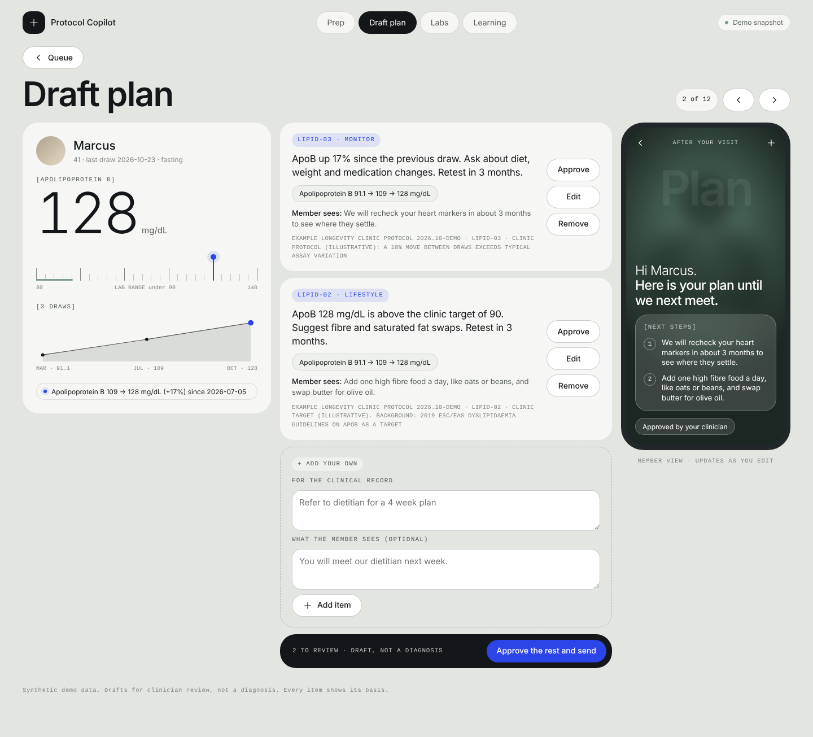

# Protocol Copilot


One clinician can only prep so many members. Somewhere around 250 to 300 members, one-to-one longevity care stops scaling. Most of that ceiling is prep: reading lab PDFs, spotting what moved, writing the plan, then writing it again for the member.

Protocol Copilot drafts that work. The clinician edits and approves every word.



## What it does

1. **Reads lab PDFs** into structured values with LOINC codes. Converts units. Rejects what it cannot trust.
2. **Tracks trends** across draws and wearable summaries. What changed since the last visit and what is moving the wrong way.
3. **Drafts the plan** from the clinic's own protocol. Every item shows the rule, the values that triggered it and the guideline behind it.
4. **Writes the member version.** Calm. No scores. Three next steps at most.
5. **Learns from edits.** Tracks which rules clinicians keep rewriting so the protocol gets fixed.
6. **Ships with a test set.** 52 tricky cases with a published pass rate.

## The one design rule

**Rules decide. The model only reads.**
Protocol rules are plain YAML and fire in code. An LLM is optional and only transcribes unfamiliar PDF layouts. Its output goes through the same unit and plausibility checks as the built-in parser.

## Guardrails

| Situation | What happens |
|---|---|
| Critical value (K 6.3) | Fixed thresholds, no model. Member summary blocked until the clinician logs contact |
| Two draws 10 days apart disagree | Rules on that marker pause. A retest item is drafted instead |
| Lp(a) switches from nmol/L to mg/dL | Not compared. Flagged as a method change |
| Potassium printed as 45 | Held as implausible. Not used, not called critical |
| Non-fasting glucose | Fasting rules skip it |
| Wearable gaps | No trend claimed |
| Condition names or scores in member text | Blocked by a word list |

Regulatory notes against FDA's January 2026 CDS guidance: [docs/COMPLIANCE.md](docs/COMPLIANCE.md)

## Test set

[evals/RESULTS.md](evals/RESULTS.md) lists every case and its result. Groups: critical values, conflicting data, fasting, units, missing data, thresholds, wearables, member text and PDF extraction.

These cases were written alongside the code. Clicking through the console found one bug the first 51 missed: after a call about a critical value, the member summary said "Your results look steady." Case P04 now covers it. The set was also mutation checked (removing the critical check, the conflict check or the fasting check each makes cases fail) but the real test is cases written by a clinician who never saw the code. That is the next step.

## The number: minutes saved

Not estimated. Measured with a timed study: [docs/TIMED_STUDY.md](docs/TIMED_STUDY.md). Results get published with the sample size.

## The console

A clinician works the queue, opens a member, and approves, edits, removes or adds items. The member's phone view updates live as they edit. Critical members stay held until the clinician ticks that they called. Every approval feeds the Learning tab.

- `uvicorn copilot.api:app` then open http://localhost:8000 for the live version
- `console/dist/demo.html` is a single-file demo with the synthetic cohort baked in
- `python scripts/build_console.py` rebuilds both

## Run it

```bash
pip install -e ".[dev]"
python scripts/demo.py M1002        # builds the synthetic cohort, prints a draft
pytest -q                           # 57 tests
python -m evals.run_evals           # writes evals/RESULTS.md
uvicorn copilot.api:app --reload    # API for the console
```

Optional LLM extraction for unknown layouts: `pip install -e ".[llm]"` and set `ANTHROPIC_API_KEY`.

## Layout

```
copilot/
  catalog.py   analytes, LOINC, units, plausible and critical ranges
  extract.py   PDF -> validated values (parser + optional LLM, one validator)
  trends.py    deltas, conflicts, stale data, wearable trends
  rules.py     protocol YAML engine
  plan.py      critical guardrail + draft plan with evidence
  member.py    calm member summary from approved items
  edits.py     edit diffs and per-rule learning stats
  api.py       FastAPI, serves the console at /
  snapshot.py  one payload with everything the console needs
console/       clinician console (app.html is the source)
protocols/clinic_protocol.yaml   example protocol, every rule cites a source
evals/                           test set and results
design/                          console concept
```

## Data

Every lab report, member and wearable series here is synthetic and watermarked. No real patient data. Thresholds are illustrative. A clinic replaces the protocol file with its own.

Pairs with [Retention Radar](https://github.com/DrDanXD/retention-radar). Radar protects revenue. Copilot creates capacity.
